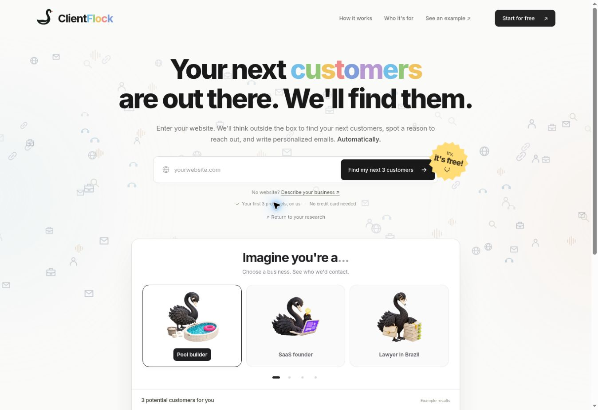
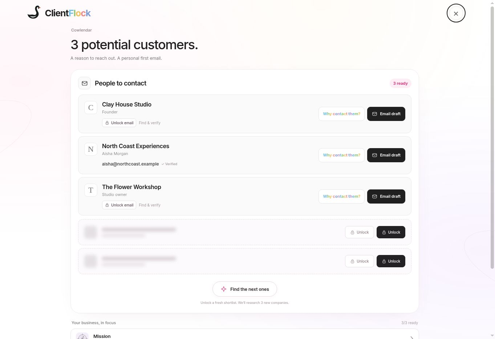

# ClientFlock

A Cloudflare Workers + D1 MVP: website or business description → mission → market research → ideal-client lists → 3 sourced companies → checked source quotes → short email drafts → separate factual review.

One centered landing page at `/`. Legacy `/split.html` links redirect to it. Eleven illustrated profession examples rotate three at a time, with accessible pagination dots and no arrow or pause controls. Examples are clearly fictional; actual searches use the server pipeline.

## Research interface

A centered black swan changes between thirty playful illustrations with colorful props. An animated vivid pink, orange and violet progress bar shows the percentage of server research steps completed. Approximate remaining time adapts to observed stage durations; it is an estimate, not a completion promise. One short stage label explains the actual work. Transitions respect reduced-motion preferences. Three compact customer rows show email addresses or their unlock action directly. The letter-colored “Why contact them?” action opens the evidence and fit, while a separate editable email draft stays saved locally per search and company. Copy and mailto actions use the edited draft. A verified email newly found through a user-requested lookup triggers confetti; cached results do not. A flock takes flight on research completion, with reduced-motion support. Mission, Market and Ideal Customers stay visible underneath as clickable document rows with the original icons, highlights, full text, priority tables and sources. Blurred skeleton rows retain visible Unlock actions and one “Find the next ones” continuation button. They explicitly describe a new search, without inventing hidden prospects or implying they have already been found.

The screenshot uses fictional visual-test data. This fixture is not shipped or used for live research.

## Runtime

- `server/research.mjs`: HTTP API, resumable stages, Responses API background jobs, source verification, budgets.
- `server/contacts.mjs`: optional Icypeas decision-maker and professional-email lookup, with durable state and credit safeguards.
- `server/company-contacts.mjs`: bounded first-party contact-page crawl for published company mailboxes and strictly evidenced professional identities.
- `db/schema.ts`, `drizzle/`: D1 schema and migrations.
- `public/`: assets, profession demos, live research interface.
- `content/`: landing HTML.
- `worker/`: existing Sites-hosted Cloudflare runtime.
- `cloudflare/`: standalone Worker entry and Wrangler configuration for your own Cloudflare account. No framework build needed for this entry.

The model defaults to `gpt-6-luna`. Configure `OPENAI_MODEL` to change it. After a failed formatting or sourcing validation, a bounded repair uses `gpt-6.1-sol` (override with `OPENAI_FALLBACK_MODEL`). The search stops after at most 24 provider submissions. OpenAI web search discovers companies; bounded HTTP fetches check exact prospect quotes against source pages. Pages that cannot be checked cause an explicit pause. No paywall, no automatic email sending.

## Cloudflare deployment in your account

Install with `npm install` (Node >=22.13), then authenticate Wrangler with your Cloudflare account. Create D1 using `npx wrangler d1 create clientflock`, and put its returned `database_id` in `cloudflare/wrangler.jsonc` under `d1_databases`. Apply schema with `npx wrangler d1 migrations apply DB --remote --config cloudflare/wrangler.jsonc`. Deploy with `npx wrangler deploy --config cloudflare/wrangler.jsonc`.

Set `OPENAI_API_KEY` as an encrypted Cloudflare Worker secret using the Cloudflare dashboard. Do not put it in source, GitHub, browser code or a public environment variable. The existing managed deployment alternatively supports an RSA-OAEP/SHA-256 encrypted key envelope via two server secrets, `OPENAI_KEY_CIPHERTEXT` and `OPENAI_KEY_PRIVATE_JWK`, decrypted only in server memory. Neither secret belongs in Git.

The standalone deployment is separate from the existing managed Site. Creating the GitHub repository does not connect it to your own Cloudflare account. D1 and secrets must be provisioned in that account.

## Optional Icypeas connection

Deploy this source update first. In your Cloudflare dashboard, open the deployed ClientFlock Worker, then **Settings > Runtime variables and secrets > Add variable**. Select **Secret**, use the exact name `ICYPEAS_API_KEY`, paste the value labeled **API Key** in Icypeas into the value field, and select **Deploy**. Do not use the separate **API Secret**: it is used for webhook signature verification and is not needed by this polling integration. This is a runtime secret, not a variable in **Builds**. Never add the key to browser code, GitHub, a README or a chat message.

`GET /api/health` returns `contacts: true` when the runtime has D1 and that secret. This is a configuration check, not a successful authenticated provider test. Company research still uses the existing OpenAI setup.

For a completed search, `POST /api/search/:id/contacts` with `{"leadIndex":0}` looks for one current decision maker at that company's exact domain. It starts with up to ten candidates and localized role titles. If no suitable candidate is found, it checks the company's published contact/team pages, then can run a bounded company-only discovery with up to twenty candidates. Each additional provider discovery consumes a normal lookup allowance. A subsequent call submits an asynchronous email search; later calls read its saved result. Each request performs at most one provider operation. Responses contain `{contact:{status,person?,email?,certainty?,message?,retryable?,errorCode?},retryAfterMs?}`. Respect `retryAfterMs` while status is `working`.

The adapter trims surrounding whitespace and sends the raw **API Key** in `Authorization`, without a `Bearer` prefix and without the API Secret, as required by Icypeas. A personal email search already returns a certainty, so it does not pay for a second verification. A company mailbox found on its own website is submitted to the Icypeas email-verification endpoint; publication alone is never labeled verification. It remains explicitly identified as a company inbox, not a named decision maker. `ultra_sure` and `very_sure` become `found`; `probable` remains `risky`; missing or unusable results remain explicit. It never constructs a guessed email address, sends outreach, or exposes the API key.

Contact state is saved per prospect in the search's D1 data. A 90-second lease prevents concurrent duplicate work, three contacts are allowed per search, and requests have a three-second job-wide cooldown. Defaults are nine new contact lookups per IP/user/day, 30 per deployment/day, and at most 20 result reads per minute with an account-wide three-second read slot. `ICYPEAS_USER_DAILY_LIMIT` and `ICYPEAS_DAILY_CONTACT_LIMIT` can lower or deliberately adjust the daily caps. These budgets apply to this deployment; other applications sharing the same key must reserve their own capacity. Final results are reused within the search's seven-day cache.

Paid discovery and email-search submissions are marked durably before the request. An uncertain timeout or crash is stopped rather than automatically resubmitted, because `custom.externalId` is not a documented provider idempotency guarantee. A provider search ID is saved before polling. A definite HTTP 401/403 is different: the rejected operation can be safely retried after correcting the runtime API Key. It returns `errorCode: "auth_configuration"` and `retryable: true`. Use `POST /api/search/:id/contacts` with `{"leadIndex":0,"retry":true}`; ordinary polling never retries it automatically. The saved operation resumes at people discovery, email creation or the existing provider result read, preserving completed work. The same failing key has a 30-second retry cooldown; a changed key can resume immediately, subject to the normal job/provider rate limits. Earlier cached authentication failures are recognized as retryable too. Unknown timeouts and ambiguous paid submissions remain nonretryable. Errors are explicit and no live authenticated Icypeas call was made during implementation.

**People response contract:** the official `/find-people` response accordion documents a `leads` array with `firstname`, `lastname`, `profileUrl`, `lastJobTitle` and `lastCompanyWebsite`. The adapter accepts that shape and still requires a matching company domain, a relevant role and a public professional profile. The search request itself restricts the current employer. Tests use this documented schema; a real authenticated result from the deployed account remains the final integration check. No email is invented when no suitable person is found. Legacy narrow-search no-match results expose `errorCode: "people_no_match"`, `retryable: true`, and `requiresNewLookup: true`; an explicit broader retry requires `retry: true` and `allowNewLookup: true` and can use credits. Updated exhausted searches stay cached, and unknown paid outcomes cannot be retried automatically.

A bounded people-response snapshot is saved server-side before interpretation. A later parser retry can reuse that snapshot without another discovery call. Earlier unsupported-response errors have no saved snapshot; their retry explicitly warns that a new lookup may use credits and requires `allowNewLookup: true` alongside `retry: true`. Unknown paid timeouts remain nonretryable. The public contact response exposes the recovery flags, never the provider snapshot.

Docs: [Icypeas authentication and first request](https://api-doc.icypeas.com/getting-started/), [people discovery](https://api-doc.icypeas.com/leads-db/find-people/), [email search results](https://api-doc.icypeas.com/fetch-results/search-item/), [certainty](https://api-doc.icypeas.com/how-works/certainties/), [rate limits](https://api-doc.icypeas.com/how-works/rate_limits/).

## Report language and presentation

The input business website's written content determines report language. Country, market, domain suffix, source language and interface language do not override it. A business description uses its own language. The model must provide a short language-evidence quote that is checked against the description or a readable first-party page. Missing or uncheckable evidence falls back to English.

All three reports retain their full Markdown document and add `presentation: {title, subtitle, highlights}` with three or four labeled highlights. The resolved language applies to headings, summaries, prospect snippets and email drafts. Exact source quotes, names and URLs remain unchanged. Missing metadata, wrong language codes and incorrect expected headings trigger bounded repair.

## Platform qualification

Mandatory installation platforms are grounded in the product website, an official app listing or the submitted business description. A Shopify-only booking app requires Shopify merchants; an agency merely offering Shopify services does not. The requirement follows the ideal-customer research into discovery and verification.

`server/platform.mjs` checks the current prospect homepage for storefront evidence such as an executable `Shopify.shop` assignment, a Shopify storefront script/style or a myshopify canonical URL. A Shopify mention, ordinary link or product image alone is insufficient. Unconfirmed or inaccessible sites are not accepted for a Shopify-required search; discovery must replace them before drafting. Each accepted prospect exposes the checked website, timestamp and technical evidence. This verifies the platform, not purchase intent or whether the merchant already uses a competing app. Only Shopify is automatically supported at present; other mandatory platforms stop with an explicit message.

Older cached searches expose a recheck action and withhold unqualified leads and contact lookups. `POST /api/search/:id/requalify` starts the new qualification pipeline or joins a matching current cache entry. Requalification can use the normal research allowance and provider calls. No database migration is required.

## Cache and resumption

Public website input is canonicalized to HTTPS hostname, stripping `www`, path and query. Cache version `v3-platform-fit`, TTL 7 days. Earlier results require requalification before their leads or emails can be shown or enriched. Simultaneous equivalent searches join one row through a unique key. Completed results cause no provider calls. Descriptions receive a private random cache key and cannot be looked up by submitting the same text. Search IDs are unguessable bearer capabilities: keep them private. The UI stores only the resume ID on the current browser. Stages advance while the research window is open; completed work persists when closed. OpenAI background calls already launched may finish after close.

`POST /api/search/:id/more` reuses the completed understanding and three documents, starts at stage 4, and excludes all previous batch domains. The next batch has a deterministic cache key and is reused by repeated/concurrent requests. It carries `data.pagination: {page, previousId, rootId, maxPages:3}` so the UI can return to earlier results. Each new batch uses the normal research budget; a chain stops after nine companies. No paywall or automatic outreach is added.

D1 leases prevent simultaneous stage processing. The OpenAI research pipeline has a small crash window between creating a provider request and saving its ID; an interrupted submission can be retried and charged again. Search budget: 20 new jobs/day globally, 5/day per IP (user ID/local fallback), and 100 provider requests/day globally. Configure limits deliberately before public launch. These are count limits, not exact currency caps; set a provider spending budget too. Expired rows are replaced when searched again; no scheduled deletion is implemented yet.

## Reliability and current limits

- Three documents are generated before company research. Word ranges checked: 200–300 / 250–350 / 500–700. A failed formatting or sourcing constraint receives at most two repair attempts, then pauses.
- Market figures are instructed to be sourced; figures are not independently recalculated. Documents distinguish hypotheses from observed facts.
- Source pages are crawled first (official homepage fallback if necessary). The email stage selects an exact 6–25 word quote from the fetched text and drafts from it; the quote is matched against that text before the result is accepted. This confirms the quoted text, not the prospect's purchasing intent or every generated inference.
- Emails are drafts: subject lowercase, <=6 words, no emoji; <=6 short sentences and a final question. A separate model pass checks the drafts against verified quotes and the offer; this is an additional guard, not a guarantee. Review before sending.
- Icypeas is optional and no credential was added during development. Without it, results provide a company contact page and a suggested decision-maker role. With it, contacts come from provider-returned professional identities or exact first-party company evidence, with actual verification certainty and source links. No sending is implemented. Findymail and FullEnrich are not connected.
- No browser-rendering fallback yet. Blocked or JavaScript-only source pages can pause the verification step. HTTP safety rejects non-public hostnames/IPs, non-HTTPS sources, credentials and custom ports and checks DNS for redirects; DNS rebinding remains a limitation of preflight DNS plus fetch and should be hardened before untrusted public deployment.
- Origin checks and application rate budgets are included. The current managed Site remains owner-private. Before a public launch, add Cloudflare Turnstile/rate limiting and a retention policy.

## Validation

`node --test tests/*.test.mjs` checks the research language and presentation contract, cache/origin rules, route integration and contact behavior with mocked provider responses and real in-memory SQLite. Contact checks include concurrency, durable provider IDs, uncertainty handling, certainty labels, credit limits and lease ownership. These tests do not validate the live provider account or undocumented people schema. `npm run build` validates the managed Cloudflare bundle. The standalone Worker can be checked with `npx wrangler deploy --dry-run --config cloudflare/wrangler.jsonc`.

Docs: [OpenAI models](https://developers.openai.com/api/docs/models), [Responses background](https://developers.openai.com/api/docs/guides/background), [web search](https://developers.openai.com/api/docs/guides/tools-web-search), [Cloudflare static assets](https://developers.cloudflare.com/workers/static-assets/binding/).
